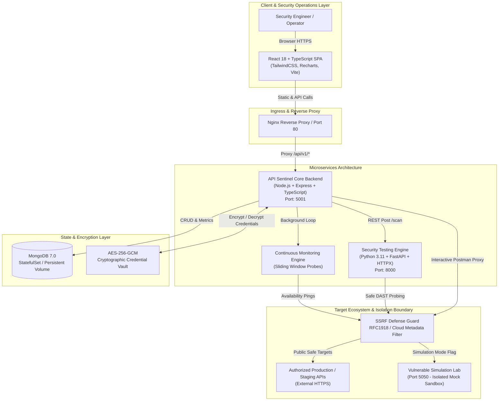

# API Sentinel - Technical Architecture & Systems Engineering

## Executive Summary
**API Sentinel** is an enterprise-grade API Security Testing & Continuous Monitoring Platform designed according to modern DevSecOps standards and the **OWASP API Security Top 10 (2023)**.

---

## 1. High-Level Architecture Diagram

---

## 2. Microservice Topology

| Component | Technology Stack | Port | Purpose |
| :--- | :--- | :--- | :--- |
| **Frontend** | React 18, TypeScript, Vite, TailwindCSS, Recharts | `80` (Nginx), `5173` (Dev) | Cybersecurity SOC dashboard, 12 interactive views, Postman-like workspace, scan reports. |
| **Backend API** | Node.js 20, Express, TypeScript, Mongoose, Axios | `5001` | Authentication (JWT/bcrypt), OpenAPI schema parsing, SSRF validation, PDF/JSON reporting. |
| **Security Engine** | Python 3.11, FastAPI, Uvicorn, HTTPX, Pydantic | `8000` | Automated evidence-based OWASP API Security Top 10 testing engine. |
| **Vulnerable Lab** | Node.js Express Isolated Service | `5050` | Safe simulation environment demonstrating 7 distinct real OWASP API vulnerabilities. |
| **Database** | MongoDB 7.0 | `27017` | Persistent storage with indexes, user tenant isolation, and volume claim persistence. |

---

## 3. OWASP API Security Top 10 Testing Engine

API Sentinel implements automated testing modules for all 10 OWASP API threat categories:

1. **API1:2023 - Broken Object Level Authorization (BOLA / IDOR):**  
   Identifies resource identifiers (`/users/{id}`, `/orders/123`), tampers with identifiers, and validates whether object ownership is enforced.
2. **API2:2023 - Broken Authentication:**  
   Probes routes marked as requiring credentials without tokens, identifies query-string token leaks (`?token=`), and detects cleartext HTTP credential transmission.
3. **API3:2023 - Broken Object Property Level Authorization:**  
   Scans response payloads for sensitive internal properties (e.g. `password_hash`, `ssn`, `private_key`, `secret_token`) and reflects on mass assignment risks.
4. **API4:2023 - Unrestricted Resource Consumption:**  
   Audits presence of rate limiting headers (`X-RateLimit-*`, `Retry-After`) and probes oversized pagination query parameters (`?limit=1000000`).
5. **API5:2023 - Broken Function Level Authorization (BFLA):**  
   Attempts invocation of privileged administrative endpoints (`/admin`, `/grant-admin`) using standard or unauthenticated tokens.
6. **API6:2023 - Unrestricted Access to Sensitive Business Flows:**  
   Audits automation defenses on critical business routes such as password reset and account checkout.
7. **API7:2023 - Server-Side Request Forgery (SSRF):**  
   Validates parameter handlers accepting arbitrary URLs with anti-loopback protections.
8. **API8:2023 - Security Misconfiguration:**  
   Inspects HTTP response headers for missing HSTS, CSP, X-Frame-Options, X-Content-Type-Options, overly permissive CORS (`Access-Control-Allow-Origin: *` with credentials), and verbose server banners (`Server`, `X-Powered-By`).
9. **API9:2023 - Improper Inventory Management:**  
   Probes for exposed unauthenticated OpenAPI/Swagger schemas (`/swagger.json`, `/openapi.json`) and deprecated endpoint versions.
10. **API10:2023 - Unsafe Consumption of APIs:**  
    Checks schema enforcement and unexpected Content-Type parsing.

---

## 4. Cryptographic Vault & SSRF Defense Guard

### Credential Protection
- Stored credentials (Bearer tokens, API keys, basic authentication passwords) are encrypted using **AES-256-GCM** with unique initialization vectors (`IV`) and authentication tags (`tag`).
- Encryption keys are retrieved from environment configuration and never hardcoded in the codebase.
- Decrypted credentials are never returned in frontend API responses or stored in logs.

### SSRF Protection
- Target URLs are validated before outbound socket creation.
- The SSRF filter enforces:
  - Protocol whitelist: `http:` and `https:` only.
  - IP range blocklist:
    - Loopback: `127.0.0.0/8`, `::1`
    - RFC1918 Private ranges: `10.0.0.0/8`, `172.16.0.0/12`, `192.168.0.0/16`
    - Cloud Metadata: `169.254.169.254` (AWS, GCP, Azure, DigitalOcean)
    - Zero addresses: `0.0.0.0/8`
  - Explicit allowlisting allows target testing against the local `vulnerable-lab` container exclusively when in Simulation Lab mode.
