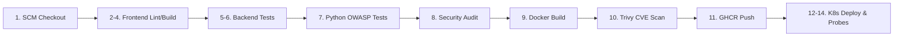

# API Sentinel - Enterprise CI/CD Pipeline Documentation

## 1. Pipeline Overview
API Sentinel implements a fully automated 14-stage Continuous Integration and Continuous Deployment (CI/CD) pipeline orchestrated using **Jenkins** and targeting a local **Kubernetes (Kind)** cluster.



---

## 2. Pipeline Stages Breakdown

### Stage 1: Checkout Source Code
- Pulls repository revisions from GitHub using Jenkins Git credentials without exposing access tokens in plaintext logs.

### Stages 2 - 4: Frontend Pipeline
- **Stage 2:** Installs frontend production and dev dependencies (`npm ci`).
- **Stage 3:** Runs static TypeScript linting (`tsc --noEmit`).
- **Stage 4:** Compiles the React + Vite production bundle (`npm run build`). Fails if compilation throws syntax or typing errors.

### Stages 5 - 6: Backend Pipeline
- **Stage 5:** Installs Node.js backend packages cleanly (`npm ci`).
- **Stage 6:** Executes the automated Jest unit test suite covering:
  - Cryptographic key verification (AES-256-GCM encryption/decryption).
  - Target allowlisting and SSRF protection (loopback, private subnets, cloud metadata blocklist).

### Stage 7: Python Security Testing Engine Tests
- Configures Python virtual environment, installs dependencies from `requirements.txt`, and runs `pytest tests/` to verify OWASP check schemas and FastAPI health endpoints.

### Stage 8: Code Quality & Secret Detection
- Scans codebase for accidentally committed secrets, raw credentials, or unencrypted keys using automated pattern matching.

### Stage 9: Multi-Stage Docker Image Build
- Assembles lightweight, minimal container images:
  - `sentinel-frontend`: Node.js build stage -> Nginx alpine runner stage.
  - `sentinel-backend`: Node.js build stage -> Node alpine runner stage.
  - `sentinel-security-engine`: Python 3.11 slim runner.
  - `sentinel-vulnerable-lab`: Isolated simulation lab container.

### Stage 10: Security Vulnerability Scan (Trivy)
- Audits generated container base images and application dependencies for critical and high CVEs using Trivy.

### Stage 11: Push to GitHub Container Registry (GHCR)
- Authenticates securely to `ghcr.io` using Jenkins credential bindings (`withCredentials`) and tags images with build numbers (`BUILD_NUMBER`).

### Stages 12 - 14: Local Kubernetes (Kind) Deployment & Verification
- **Stage 12:** Applies Kubernetes manifests in order: namespace, secrets/configmaps, MongoDB StatefulSet, security engine, backend, vulnerable lab, and frontend NodePort service.
- **Stage 13:** Executes `kubectl rollout status` with 120s timeout on all Deployments and StatefulSets to guarantee readiness.
- **Stage 14:** Runs cluster health checks verifying HTTP endpoints and persistent volume attachment.

---

## 3. Jenkins Credentials Configuration

| Credential ID | Kind | Purpose |
| :--- | :--- | :--- |
| `github-container-registry-auth` | Username with Password | Used in Stage 11 for authenticated push to `ghcr.io/yalavarthijaswanth/*`. |
| `kind-kubeconfig` | Secret File / Agent Path | Allows Jenkins agent to communicate with local Kind control plane. |

---

## 4. Local Execution & Kind Trigger Command

To execute the deployment locally without Jenkins:
```bash
# 1. Ensure Kind cluster is running
kind get clusters

# 2. Build local Docker images
docker compose build

# 3. Load images into Kind
kind load docker-image sentinel-frontend:latest --name cloudops-local
kind load docker-image sentinel-backend:latest --name cloudops-local
kind load docker-image sentinel-security-engine:latest --name cloudops-local
kind load docker-image sentinel-vulnerable-lab:latest --name cloudops-local

# 4. Apply Kubernetes manifests
kubectl apply -f k8s/00-namespace.yaml
kubectl apply -f k8s/01-secrets-configmap.yaml
kubectl apply -f k8s/02-mongodb.yaml
kubectl apply -f k8s/03-security-engine.yaml
kubectl apply -f k8s/04-backend.yaml
kubectl apply -f k8s/05-vulnerable-lab.yaml
kubectl apply -f k8s/06-frontend.yaml

# 5. Verify rollout
kubectl get pods -n api-sentinel -o wide
```
